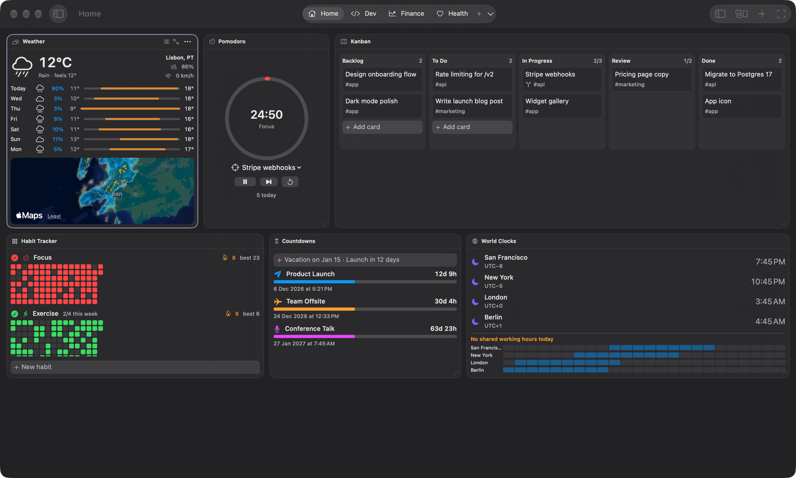
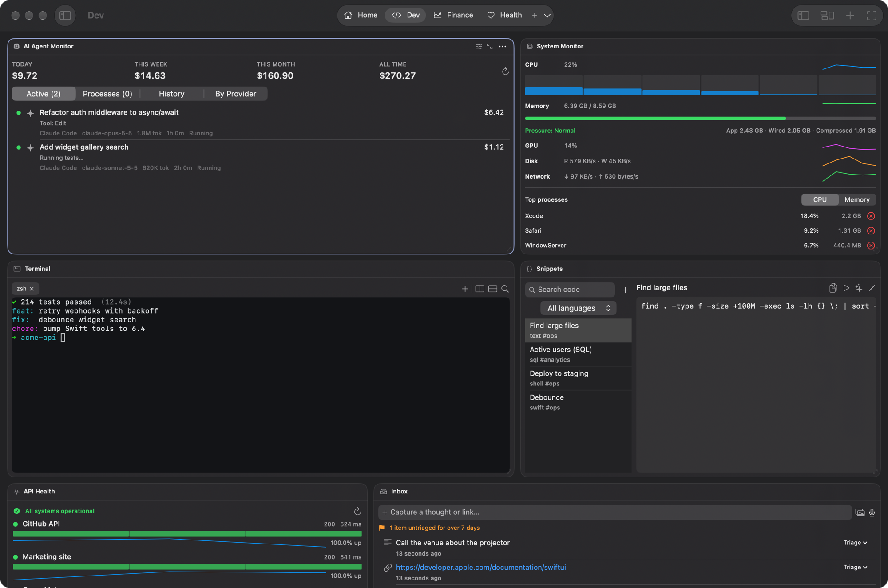
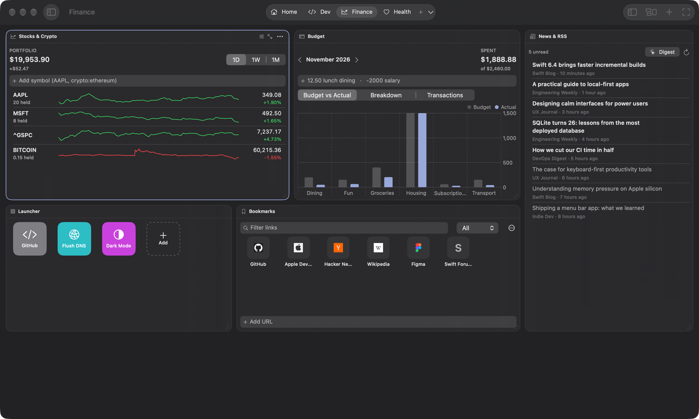
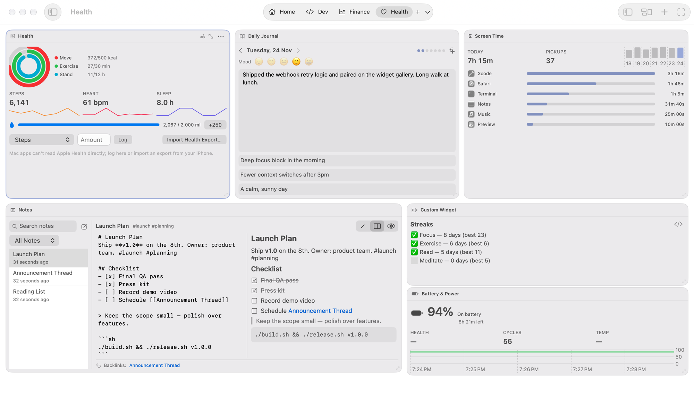
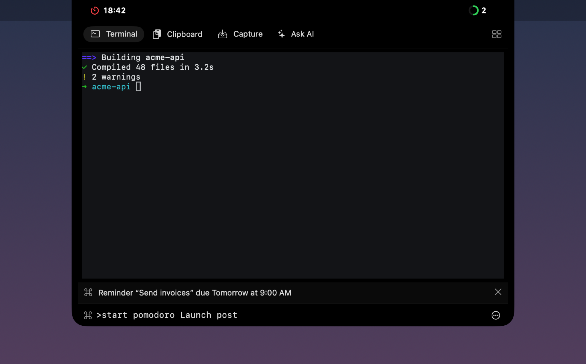
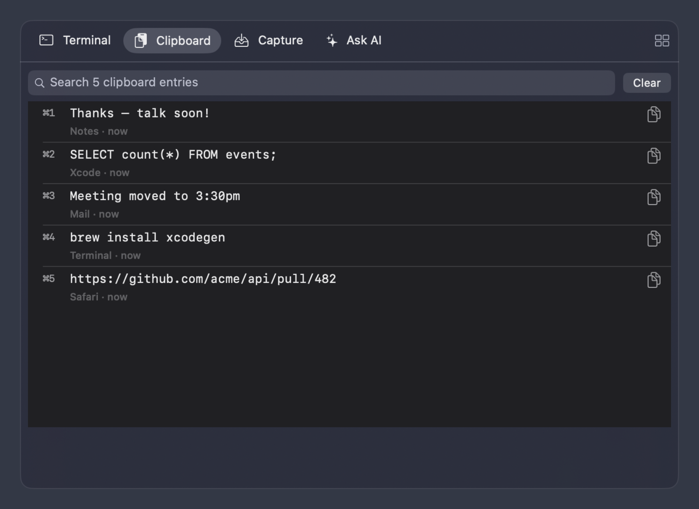
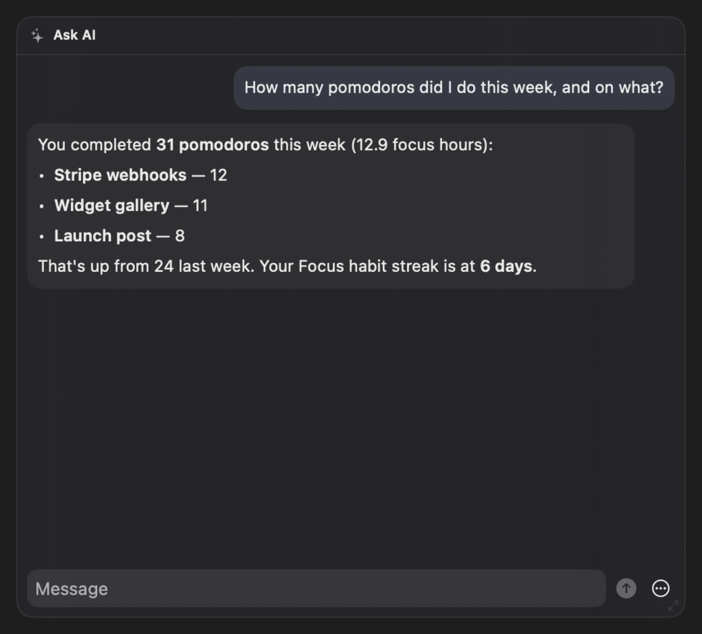
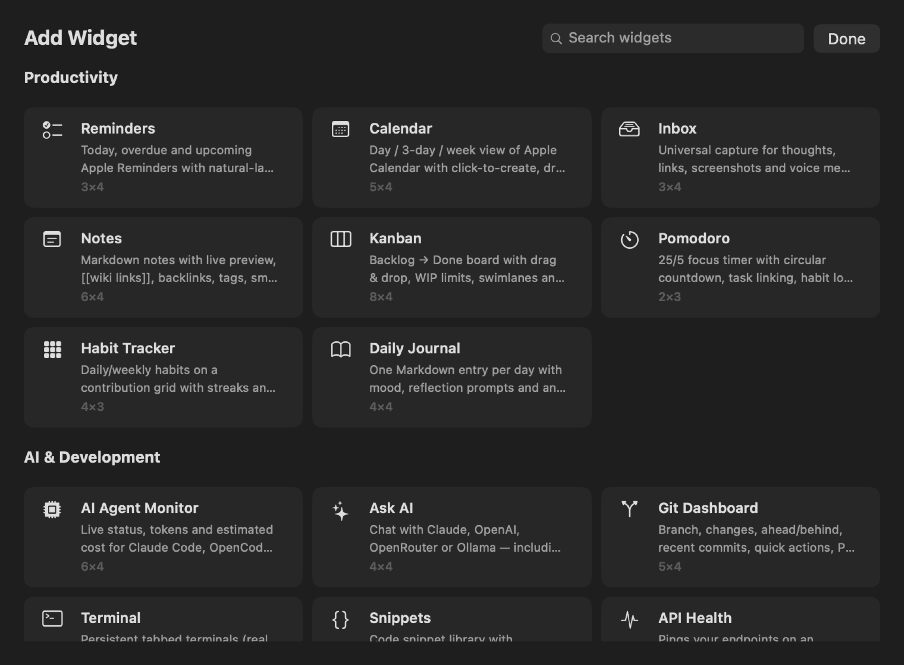

# Command Center

A native macOS (SwiftUI, macOS 14+) productivity dashboard that lives both as a full window of draggable, resizable widgets and as a menu bar utility with a real terminal, command palette, clipboard history, quick capture and AI.

- **31 widget modules** on a snapping grid, organised into workspaces (Home, Dev, Finance, Health by default).
- **Notch island**: a Dynamic Island–style panel that grows out of the MacBook notch (or the top centre of the menu bar on other Macs), with a live activity for the pomodoro timer and running AI agents. It can be switched off for a classic menu bar dropdown.
- **Menu bar terminal** (⌘⇧Space), command palette, clipboard history, quick capture and Ask AI. Opening it never brings the dashboard window forward; ⌘Q closes the dashboard but keeps the app in the menu bar.
- **Local-first**: SQLite (GRDB) + Markdown files in `~/Library/Application Support/CommandCenter/`. Secrets live in the Keychain. No telemetry.



<table>
<tr><td></td>
<td></td></tr>
<tr><td></td>
<td></td></tr>
<tr><td></td>
<td></td></tr>
<tr><td></td>
<td></td></tr>
</table>

<sub>Screenshots are generated from sample data (`Scripts/screenshots.sh`).</sub>

## Install

Download `CommandCenter-<version>.dmg` (or the `.zip`) from [Releases](../../releases) and drag **Command Center** to Applications.

The app isn't notarized, so the first launch is blocked by Gatekeeper: right-click the app → **Open** → **Open**, or run `xattr -dr com.apple.quarantine "/Applications/Command Center.app"`. macOS will then ask for permissions (Reminders, Calendar, Automation, Microphone) the first time a widget needs them.

## Build & run

Requirements: Xcode 16+ (tested with Xcode 27), [XcodeGen](https://github.com/yonaskolb/XcodeGen) (`brew install xcodegen`).

```sh
./build.sh            # generates the Xcode project and builds Debug
open "build/DD/Build/Products/Debug/Command Center.app"
./build.sh test       # full test suite (runs inside the app, isolated data dir)
Scripts/release.sh    # Release build → build/dist/*.zip and *.dmg (ad-hoc signed)
```

`build.sh` signs with your local "Apple Development" certificate when one exists (via a git-ignored `Local.xcconfig`), so Keychain items stay readable across rebuilds. Without one it falls back to ad-hoc signing.

## Widgets

| Area | Widgets |
|---|---|
| Productivity | Reminders (EventKit, natural-language add, snooze, drag priority) · Calendar (day/3-day/week, click-to-create, drag-to-resize, conflicts in red) · Inbox (text/links/screenshots/voice memos, triage to reminder/event/note/Kanban, stale flags, AI triage suggestions) · Notes (Markdown, live preview, `[[wiki links]]`, backlinks, tags, smart folders, FTS5 search) · Kanban (WIP limits, swimlanes, links) · Pomodoro (circular timer, task link, habit logging, distracting-app hiding) · Habit Tracker (contribution grid, streaks, auto-complete from other widgets) · Daily Journal (mood, prompts, AI weekly summary) |
| AI & Dev | AI Agent Monitor (Claude Code, OpenCode, Codex, Aider, Cursor/Windsurf processes, custom agents; status, tokens, estimated cost by day/week/month/all-time, kill, searchable history) · Ask AI (chat about your own data) · Git Dashboard (status, ahead/behind, commits, pull/push/stash/switch, GitHub/GitLab PRs, heatmap) · Terminal (SwiftTerm PTYs, tabs, splits, search, clickable paths/URLs, drag-in text) · Snippets (highlighting, FTS, language detection, run in terminal, AI explain) · API Health (interval pings, latency sparkline, uptime, down/recovery notifications) |
| System | System Monitor (per-core CPU, memory pressure, GPU, disk I/O, network, top processes with kill; Mach/IOKit/libproc, no shelling out) · Network (IPs, interface, live bandwidth, connections, ping graph) · Disk & Storage (treemap, largest files, trash, drives with eject) · Battery & Power (health, cycles, temperature, history) |
| Information | Email (Apple Mail: unread, latest, archive/read/flag, VIP filter) · Weather (Open-Meteo forecast, RainViewer radar, severe alerts) · News & RSS (reader view, AI daily digest, save to Notes) · Bookmarks (favicons, folders, Chrome/Safari import, dead-link checker) |
| Finance | Stocks & Crypto (Yahoo Finance / CoinGecko, 1D/1W/1M sparklines, alerts, portfolio) · Budget (quick entry, budget vs actual, donut breakdown, recurring expenses) |
| Lifestyle | Health (rings, steps, heart rate, sleep, water, Apple Health export import) · Now Playing (Apple Music / Spotify) |
| Utility | World Clocks (meeting planner, contacts per city) · Countdowns (milestone notifications) · Screen Time (tracked on this Mac) · Launcher (Shortcuts, shell, AppleScript, URLs, apps) · Custom Widget (JavaScriptCore runtime, editor with live preview, `.ccwidget` sharing, sample gallery) |

## Dashboard

- Drag a widget by its header to move it; drag the bottom-right corner to resize. Only widgets you collide with get pushed down; everything else stays put. **Tidy Up** (⌘⇧L) closes gaps when you want it to.
- Workspaces live in the toolbar: switch with ⌘1–⌘9, swipe, or ⌘⌥←/→. Manage them (rename, icon, reorder, delete, including the defaults) from the chevron menu or **Workspace → Manage Workspaces…** (⌘⇧M).
- Keyboard: arrow keys move focus between widgets, ⌥-arrows move, ⌥⇧-arrows resize, Return toggles Zen mode (⌘⇧Z).
- Optional widget-list sidebar (⌃⌘S), themes, accent colour, text size and Touch ID app lock in Settings.
- Export and import layouts as JSON (Settings → Data).

## Menu bar & notch island

By default the menu bar panel opens as an **island** from the notch: hover the notch (or press ⌘⇧Space) to expand it, and move away or press Esc to collapse it. While a pomodoro runs or AI agents are working, the collapsed island widens into a live activity showing the timer and the agent count. On Macs without a notch it hangs from the top centre of the menu bar. Settings → General → Notch island lets you turn it off (classic dropdown under the menu bar icon) or disable hover-to-open and the live activity.

| Shortcut | Action |
|---|---|
| ⌘⇧Space | Toggle the menu bar terminal |
| ⌘⇧N | Quick capture to Inbox |
| ⌘⇧A | Ask AI |
| ⌘⇧P | Command palette (`>` prefix) |
| ⌘Q / ⌥⌘Q | Close to menu bar / quit completely |

Palette commands include `>new reminder Buy milk tomorrow 3pm`, `>new event`, `>capture`, `>new note`, `>new card`, `>start pomodoro`, `>ask claude "summarize my day"`, `>switch workspace Dev`, `>add widget weather`, `>log habit`, `>run snippet`, `>zen`, `>theme dark` and `>help`. When an AI provider is configured, free-form requests are mapped onto commands.

## AI providers

Settings → AI: Anthropic (default model `claude-opus-5-5`, streamed over the Messages API with server-side refusal fallback enabled), OpenAI, OpenRouter, or a local Ollama (auto-detected). Keys are stored in the Keychain and saved as you type.

## Limitations so far

- **Health**: macOS apps can't read the Health database without Apple's restricted HealthKit entitlement. The widget uses manual logging and imports Apple Health exports (`export.xml`).
- **Screen Time**: Apple's Screen Time data isn't available to third-party apps, so usage is measured by Command Center itself while it runs.
- **Email**: works through Apple Mail (add IMAP accounts to Mail). Direct IMAP isn't implemented.
- **Calendar travel time**: EventKit doesn't expose it, so locations are shown instead.
- **Cursor / Windsurf**: detected as running processes; their token usage isn't readable.
- **Encrypted database**: Touch ID app lock is implemented, but SQLCipher encryption is not.
- **Community widget gallery**: placeholder only. Share widgets as `.ccwidget` files.
(Please feel free to make a PR if you want your widget added into Command Center)

## Architecture

```
CommandCenter/
  App/          entry point, AppDelegate (status item, hotkeys, ⌘Q-to-menu-bar)
  Core/         grid engine + drag sessions, DashboardWidget protocol, registry, WidgetBus,
                coalesced TickScheduler, GRDB database, Keychain, AI service, terminal sessions
  Dashboard/    grid view, widget card chrome, toolbar/workspaces, settings, onboarding
  MenuBar/      notch island, non-activating dropdown panel, quick terminal, clipboard ring, capture, palette
  Widgets/<Name>/  <Name>Widget.swift · <Name>ViewModel.swift · <Name>Configuration.swift · <Name>Store.swift
CommandCenterTests/  87 tests: grid + real-mouse drag tests, every widget's logic, rendering/pixel tests, notch geometry
Scripts/        release.sh (zip + DMG), screenshots.sh (sample-data screenshots), make-icon.swift
```

Each widget conforms to `DashboardWidget`, declaring its min/default size, refresh interval and a `WidgetConfiguration` whose editor doubles as its settings schema. Widgets talk to each other through `WidgetBus` (for example, a finished pomodoro ticks the Focus habit). Polling widgets share one coalesced timer that only runs while subscribers are visible.
